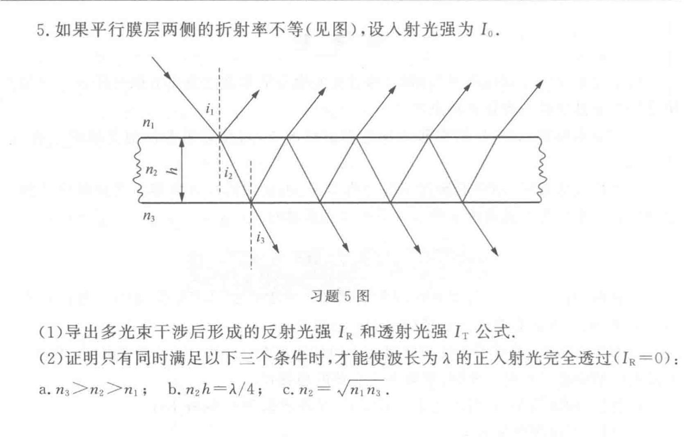

# 平行膜两侧折射率不同时的多光束干涉与增透膜

整理日期：2026-11-02。题面来自用户截图“截屏2026-11-02 15.38.09.png”，标为第 5 题；书名与原书页码未核实，不与已有习题 5 自动对应。

## 题面

如果平行膜层两侧的折射率不等，设入射光强为 $I_0$。入射侧、膜层、透射侧的折射率分别为 $n_1,n_2,n_3$，膜厚为 $h$，对应光线与法线的夹角为 $i_1,i_2,i_3$。

1. 导出多光束干涉后形成的反射光强 $I_R$ 和透射光强 $I_T$ 公式。
2. 原题要求证明：只有同时满足 $n_3>n_2>n_1$、$n_2h=\lambda/4$、$n_2=\sqrt{n_1n_3}$，才能使波长为 $\lambda$ 的正入射光完全透过，即 $I_R=0$。

**题面限定的补充：**第二问列出的是 $n_3>n_1$ 时最薄的单层增透膜。一般还允许奇数倍四分之一波长厚度；若 $n_1>n_3$，反向的折射率排列同样成立。下面证明完整条件。

## 1. 模型与符号

假设三种介质均为普通透明、无吸收、非磁性介质，折射率为正实数；图示各介质中均有传播光，无全反射。各束光相干，在重叠区或合适的观察光路中叠加。$\lambda$ 为真空波长。

斜入射时，先对一种确定的偏振（s 或 p）计算。记 $r_{ab}$、$t_{ab}$ 为从介质 $a$ 入射到介质 $b$ 的菲涅耳**电场振幅**反射、透射系数。采用一致的偏振基矢约定，有

$$
r_{21}=-r_{12},\qquad t_{12}t_{21}=1-r_{12}^2.
$$

这里 $r_{ab}$ 保留正负号，不是非负的反射率 $R_{ab}=|r_{ab}|^2$。反射的相位变化已包含在 $r_{ab}$ 中，不再额外添加“半波损失”。

例如 s 偏振：

$$
r_{ab}^{(s)}=
\frac{n_a\cos i_a-n_b\cos i_b}{n_a\cos i_a+n_b\cos i_b},
\qquad
t_{ab}^{(s)}=
\frac{2n_a\cos i_a}{n_a\cos i_a+n_b\cos i_b}.
$$

p 偏振采用相应的菲涅耳系数，后面的求和结构不变。自然光应将等强的 s、p 入射分量分别计算，再相加强度。

斯涅耳定律为

$$
n_1\sin i_1=n_2\sin i_2=n_3\sin i_3.
$$

定义一次穿膜的相位厚度和往返的传播相位差：

$$
\beta=\frac{2\pi}{\lambda}n_2h\cos i_2,
\qquad
\delta=2\beta=\frac{4\pi}{\lambda}n_2h\cos i_2.
$$

**为何是 $\cos i_2$ 而不是 $1/\cos i_2$？**要比较同一出射波面上的相位。膜内多走的光程是 $2n_2h/\cos i_2$，还要扣除横向错位对应的外部光程：

$$
\Delta=
\frac{2n_2h}{\cos i_2}
-2n_1h\tan i_2\sin i_1
=2n_2h\cos i_2.
$$

最后一步用了斯涅耳定律。故 $\delta=2\pi\Delta/\lambda$。

## 2. 反射光：先相加振幅

令入射复振幅为 $E_0$。第一束是在上界面直接反射：

$$
E_{R,0}=r_{12}E_0.
$$

第二束经历“透入膜层—下界面反射—透出上界面”：

$$
E_{R,1}=t_{12}r_{23}t_{21}e^{i\delta}E_0.
$$

以后每一束比前一束多一次膜内往返，即多一次上界面内反射、一次下界面反射，以及传播相位 $\delta$。所以公比为

$$
q=r_{21}r_{23}e^{i\delta}.
$$

因此

$$
\frac{E_R}{E_0}
=r_{12}+t_{12}t_{21}r_{23}e^{i\delta}
\left(1+q+q^2+\cdots\right)
=r_{12}+
\frac{t_{12}t_{21}r_{23}e^{i\delta}}
{1-r_{21}r_{23}e^{i\delta}}.
$$

利用上面的两个界面恒等式，化简为

$$
\boxed{
r_{\mathrm{film}}\equiv\frac{E_R}{E_0}
=\frac{r_{12}+r_{23}e^{i\delta}}
{1+r_{12}r_{23}e^{i\delta}}.
}
$$

由于反射光与入射光处在同一种介质中，

$$
\boxed{
I_R=I_0
\frac{r_{12}^2+r_{23}^2+2r_{12}r_{23}\cos\delta}
{1+r_{12}^2r_{23}^2+2r_{12}r_{23}\cos\delta}.
}
$$

这一步相加的是复振幅。直接把每束光的强度相加，会丢失干涉项。

## 3. 透射光：相同公比的等比级数

第一束透射光经历上下界面各一次透射。以两个界面为相位参考面，其振幅系数为

$$
\frac{E_{T,0}}{E_0}=t_{12}t_{23}e^{i\beta}.
$$

后续每束同样多乘 $q$，所以

$$
\boxed{
t_{\mathrm{film}}\equiv\frac{E_T}{E_0}
=\frac{t_{12}t_{23}e^{i\beta}}
{1+r_{12}r_{23}e^{i\delta}}.
}
$$

若“光强”按单位垂直于各自传播方向的面积定义，则 $I\propto n|E|^2$，因此

$$
\boxed{
I_T=I_0\frac{n_3}{n_1}
\frac{t_{12}^2t_{23}^2}
{1+r_{12}^2r_{23}^2+2r_{12}r_{23}\cos\delta}.
}
$$

不能直接写成 $I_T/I_0=|t_{\mathrm{film}}|^2$，因为两侧折射率不同。

为了写出能量守恒，定义反射率和透射率为通过同一膜面面积的功率之比：

$$
\mathcal R=\frac{I_R}{I_0},\qquad
\mathcal T=\frac{I_T\cos i_3}{I_0\cos i_1}.
$$

单界面满足

$$
\frac{n_b\cos i_b}{n_a\cos i_a}t_{ab}^2=1-r_{ab}^2.
$$

于是膜的透射率为

$$
\boxed{
\mathcal T=
\frac{(1-r_{12}^2)(1-r_{23}^2)}
{1+r_{12}^2r_{23}^2+2r_{12}r_{23}\cos\delta},
\qquad \mathcal R+\mathcal T=1.
}
$$

等价地，实际光束强度为

$$
\boxed{
I_T=I_0\frac{\cos i_1}{\cos i_3}
\frac{(1-r_{12}^2)(1-r_{23}^2)}
{1+r_{12}^2r_{23}^2+2r_{12}r_{23}\cos\delta}.
}
$$

正入射时余弦比为 1，才有 $I_R+I_T=I_0$。有的教材用“透射光强”指按膜面投影归一化的量，写公式时应先明确约定。

## 4. 正入射的完全透射条件

正入射取共同的横向电场正方向，此时

$$
r_{12}=\frac{n_1-n_2}{n_1+n_2},\qquad
r_{23}=\frac{n_2-n_3}{n_2+n_3},\qquad
\delta=\frac{4\pi n_2h}{\lambda}.
$$

对有限的正折射率，$|r_{12}r_{23}|<1$，总反射振幅的分母不为零。所以完全透射等价于

$$
r_{12}+r_{23}e^{i\delta}=0.
$$

取模可得

$$
|r_{12}|=|r_{23}|.
$$

因为两个系数为实数，只有两种可能：

- $r_{12}=-r_{23}$：交叉相乘可得 $n_1=n_3$，被题设“两侧折射率不等”排除。
- $r_{12}=r_{23}$：交叉相乘可得

$$
(n_1-n_2)(n_2+n_3)=(n_2-n_3)(n_1+n_2),
$$

$$
2n_1n_3-2n_2^2=0,
\qquad
\boxed{n_2=\sqrt{n_1n_3}}.
$$

由于题设 $n_1\ne n_3$，此时 $r_{12}=r_{23}\ne0$。代回反射为零的条件，有

$$
1+e^{i\delta}=0,
\qquad
\delta=(2m+1)\pi.
$$

所以允许的正膜厚为

$$
\boxed{
n_2h=\frac{(2m+1)\lambda}{4},
\qquad m=0,1,2,\ldots
}.
$$

综上，在本题模型下，两侧折射率不等时，正入射完全透射的充要条件是

$$
\boxed{
n_2=\sqrt{n_1n_3},\qquad
h=\frac{(2m+1)\lambda}{4n_2},
\quad m=0,1,2,\ldots
}.
$$

几何平均数在两个正数之间，因此：

- 若 $n_3>n_1$，自动得到 $n_3>n_2>n_1$；
- 若 $n_1>n_3$，同样允许 $n_1>n_2>n_3$。

取最薄的一层，即 $m=0$，得到原题的 $n_2h=\lambda/4$。因此原题的三个条件在“$n_3>n_1$，选最薄膜层”的限定下成立；若按一般必要条件理解，其表述不完整。

## 5. 物理理解与检查

**为什么四分之一波长厚度能消反射？**在最薄增透膜中，一次穿膜的光学厚度为 $\lambda/4$，往返传播相位差为 $\pi$。折射率匹配 $n_2^2=n_1n_3$ 又使第一束直接反射光与所有从膜内返回光的合振幅等大反相，故总反射为零。

多光束情形中，不应把“匹配”误说成前两束实际出射反射光振幅相等：第二束还含有 $t_{12}t_{21}$，需将后续所有返回光一起求和。

例如正入射取 $n_1=1$、$n_2=1.5$、$n_3=2.25$，在奇数四分之一波长处，

$$
r_{12}=r_{23}=-0.2,\qquad
q=0.04,\qquad t_{12}t_{21}=0.96.
$$

以 $E_0$ 为单位，第一束直接反射的振幅是 $-0.2$，膜内返回各束的合振幅为

$$
0.192(1+0.04+0.04^2+\cdots)
=\frac{0.192}{0.96}=0.2,
$$

两者恰好抵消。

其他核对：

- 在奇数四分之一波长处，

$$
\mathcal R=
\left(\frac{n_1n_3-n_2^2}{n_1n_3+n_2^2}\right)^2,
$$

直接显示几何平均折射率条件。

- 膜厚趋于零时，总振幅退化为介质 1 到介质 3 的单界面系数。
- 无吸收时 $\mathcal R+\mathcal T=1$；正入射完全透射有 $I_T=I_0$，但 $|E_T/E_0|=\sqrt{n_1/n_3}$，一般不等于 1。
- 对自然光，$\mathcal R=(\mathcal R_s+\mathcal R_p)/2$、$\mathcal T=(\mathcal T_s+\mathcal T_p)/2$，因为两个入射偏振分量各占 $I_0/2$。

题面转录与图片来源见 [来源与校验](来源与校验.md)。本解析独立从菲涅耳系数和相干振幅叠加推导，未把截图的待证明结论直接当作一般必要条件。
